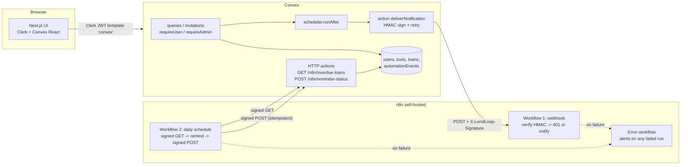

# LendLoop

> Borrow what you need. Lend what you don't.

LendLoop is a neighbourhood tool-lending board. Neighbours list tools they are willing to lend, request to borrow from each other for a date range, and get automated notifications and overdue reminders handled by **n8n**.

Stack: Next.js (App Router) · Clerk (auth) · Convex (data, backend logic, HTTP endpoints) · n8n (self-hosted via Docker) · TypeScript · Tailwind · Vitest.

## Contents

1. [Features](#features)
2. [Architecture](#architecture)
3. [Local setup](#local-setup)
4. [Environment variables](#environment-variables)
5. [RBAC model](#rbac-model)
6. [Security and data minimization](#security-and-data-minimization)
7. [Reliability](#reliability)
8. [Testing](#testing)
9. [What I would change for production](#what-i-would-change-for-production)
10. [Time spent and trade-offs](#time-spent-and-trade-offs)

## Features

| Area | What you get |
| --- | --- |
| Public page `/` | Tagline, "Sign in to lend or borrow" (Clerk modal), read-only list of tools that are not currently on loan: **name and category only**. |
| `/tools` | All tools with availability (available / reserved / on loan), filter by category, request to borrow for a date range. |
| `/my/listings` | Create, edit, delete your own tools. |
| `/my/requests` | Your borrow requests with status and automation activity ("Notification sent 2 hours ago"). |
| `/my/incoming` | Requests on your tools: approve, decline, mark handed over, mark returned. |
| `/admin` | Admin only: all loans, mark/unmark **Trusted Lender**. Admins can also remove any listing from `/tools`. |
| Automation | Convex -> n8n signed webhook on every request/status change; daily n8n schedule fetches overdue loans from Convex, sends a (mock) reminder and writes the result back idempotently. |

Loan lifecycle: `requested -> approved | declined`, `approved -> active (handed over) | returned`, `active -> returned`. A loan is **overdue** when it is `approved`/`active` and its end date (UTC) is in the past.

## Architecture



Code layout:

```
convex/
  schema.ts            users, tools, loans, automationEvents (+ indexes)
  users.ts tools.ts loans.ts   public API, every function calls requireUser/requireAdmin
  automation.ts        outbound webhook action, event claim/finish, overdue query, idempotent write-back
  http.ts              n8n -> Convex endpoints (HMAC verified)
  crons.ts             sweeper that re-drives failed notifications
  lib/
    auth.ts            requireUser, requireAdmin, assertOwnerOrAdmin
    hmac.ts            sign / verify / constant-time compare (pure, Web Crypto)
    idempotency.ts     key formats + dedup decision (pure)
    loanRules.ts       dates, overlap, state machine, overdue (pure)
src/                   Next.js app (landing, /tools, /my/*, /admin) + proxy.ts (Clerk route gate)
n8n/workflows/         exported workflow JSON (no secrets)
scripts/               build-n8n-workflows.mjs (generator), validate-n8n.mjs
tests/                 vitest: pure modules, RBAC, HTTP endpoints, n8n Code-node interop
docker-compose.yml     pinned n8n 1.123.91
```

## Local setup

Prerequisites: Node 22, pnpm 9, Docker with compose v2, a free Clerk account and a free Convex account.

### 1. Install

```bash
pnpm install
cp .env.example .env.local        # then fill in the Clerk keys (step 2)
cp .env.n8n.example .env.n8n      # then fill in (step 5)
```

### 2. Clerk

1. Create an application in the Clerk dashboard (enable email and/or social sign-in).
2. Copy the publishable and secret keys into `.env.local` (`NEXT_PUBLIC_CLERK_PUBLISHABLE_KEY`, `CLERK_SECRET_KEY`).
3. **JWT Templates -> New template -> Convex** (name it exactly `convex`). Make sure the claims include the user's name and email:
   ```json
   { "aud": "convex", "name": "{{user.full_name}}", "email": "{{user.primary_email_address}}" }
   ```
4. Note the **Issuer** of the template (your Clerk Frontend API URL, e.g. `https://your-app.clerk.accounts.dev`).

### 3. Convex

```bash
npx convex dev            # first run: log in, create a project; writes CONVEX_DEPLOYMENT + NEXT_PUBLIC_CONVEX_URL to .env.local
```

The first run will complain that `CLERK_JWT_ISSUER_DOMAIN` is missing. Set the Convex-side env vars (these live on the Convex deployment, not in `.env.local`):

```bash
npx convex env set CLERK_JWT_ISSUER_DOMAIN https://your-app.clerk.accounts.dev
npx convex env set LENDLOOP_HMAC_SECRET "$(openssl rand -hex 32)"     # remember this value for n8n
npx convex env set N8N_WEBHOOK_URL http://localhost:5678/webhook/lendloop-loan-events
npx convex env set ADMIN_EMAILS you@example.com                        # bootstrap admin(s)
```

`npx convex dev` also regenerates `convex/_generated`, which is committed so a fresh clone typechecks without a deployment. Your **HTTP actions URL** is the `NEXT_PUBLIC_CONVEX_SITE_URL` that `npx convex dev` writes to `.env.local`: `https://<deployment>.convex.site`, or `https://<deployment>.<region>.convex.site` for regional deployments (note `.site`, not `.cloud`); n8n needs it.

> Convex cloud cannot reach `localhost`. For the outbound webhook to work against a cloud dev deployment, expose n8n with a tunnel (for example `cloudflared tunnel --url http://localhost:5678` or ngrok) and set `N8N_WEBHOOK_URL` to `https://<tunnel>/webhook/lendloop-loan-events`. Also set `WEBHOOK_URL` in `docker-compose.yml` to the tunnel URL. The inbound direction (n8n -> Convex) works without a tunnel. Alternatively run a local Convex backend (`npx convex dev --local`).

### 4. Next.js

```bash
pnpm dev     # http://localhost:3000
```

Sign in once. If your email is in `ADMIN_EMAILS` you become `admin` when your profile is first created; otherwise promote later:

```bash
npx convex run users:setRole '{"email":"you@example.com","role":"admin"}'
```

### 5. n8n

Edit `.env.n8n`: set `LENDLOOP_HMAC_SECRET` (same value as in Convex), `CONVEX_SITE_URL` (the `.convex.site` URL), and a random `N8N_ENCRYPTION_KEY`. Optionally set `ALERT_WEBHOOK_URL` to a Slack/Discord incoming webhook for error alerts.

```bash
docker compose up -d
open http://localhost:5678       # create the local owner account on first run
```

### 6. Import and activate the workflows

```bash
docker compose exec n8n n8n import:workflow --separate --input=/workflows
```

Then in the n8n UI: open each workflow and **activate** it (toggle top-right). Order does not matter; the two business workflows already point at the error handler (`errorWorkflow = lendloopErrorHandler01`, imported with a fixed id). Activation is required for the production webhook URL (`/webhook/lendloop-loan-events`) and the daily schedule. You can also use "Execute workflow" on workflow 2 to run the reminder flow on demand.

(Alternative to the CLI: import the three files in `n8n/workflows/` via the UI, "Import from file", then set Workflow settings -> Error workflow to *LendLoop - Error handler* on the two business workflows.)

### 7. Try it

1. Create a second user (private window), list a tool as user A, request it as user B for a date range.
2. User A gets a notification: look at `docker compose logs -f n8n` for `[MOCK NOTIFICATION]`, and see "Notification sent ..." on the loan card.
3. Approve as A, then B is notified. To test overdue reminders, use the Convex dashboard to edit a loan's `endDate` to a past date (status `approved`/`active`), then run workflow 2 manually; you will see `[MOCK REMINDER]` and "Reminder sent ..." on the loan.

## Environment variables

| Variable | Where | Purpose |
| --- | --- | --- |
| `NEXT_PUBLIC_CLERK_PUBLISHABLE_KEY`, `CLERK_SECRET_KEY` | `.env.local` | Clerk keys. |
| `NEXT_PUBLIC_CLERK_SIGN_IN_URL` | `.env.local` | `/sign-in` (route included). |
| `CONVEX_DEPLOYMENT`, `NEXT_PUBLIC_CONVEX_URL` | `.env.local` (written by `convex dev`) | Which Convex deployment the app talks to. |
| `CLERK_JWT_ISSUER_DOMAIN` | **Convex env** | Issuer of the Clerk `convex` JWT template; used by `auth.config.ts`. |
| `LENDLOOP_HMAC_SECRET` | **Convex env** and **`.env.n8n`** | Shared HMAC secret, both directions. Same value on both sides. |
| `N8N_WEBHOOK_URL` | **Convex env** | Full production webhook URL of workflow 1. |
| `ADMIN_EMAILS` | **Convex env** | Comma-separated bootstrap admin emails (see RBAC). |
| `N8N_RETRY_BASE_MS` | Convex env (optional) | Backoff base for outbound retries, default 1000. |
| `CONVEX_SITE_URL` | `.env.n8n` | `https://<deployment>[.<region>].convex.site` (copy `NEXT_PUBLIC_CONVEX_SITE_URL`), base for the HTTP endpoints. |
| `ALERT_WEBHOOK_URL` | `.env.n8n` (optional) | Slack/Discord incoming webhook for failure alerts. |
| `N8N_ENCRYPTION_KEY`, `GENERIC_TIMEZONE` | `.env.n8n` | n8n credential encryption key, timezone. |
| `N8N_BLOCK_ENV_ACCESS_IN_NODE=false`, `NODE_FUNCTION_ALLOW_BUILTIN=crypto` | `docker-compose.yml` | Let Code nodes read `$env.*` and use `crypto`. |

Only placeholders are committed (`.env.example`, `.env.n8n.example`). Real `.env*` files are git-ignored.

## RBAC model

Two roles, stored in the Convex `users` table (`role: "admin" | "user"`, `trustedLender: boolean`). The role is **never** read from the client or from the JWT.

- **Authentication**: `requireUser(ctx)` resolves the verified Clerk identity (`ctx.auth.getUserIdentity()`) to a `users` row; `requireAdmin(ctx)` additionally checks `role === "admin"`. Every public query/mutation calls one of them first. The single exception is `tools.listPublic`, which returns only `name` and `category`.
- **Ownership checks live in the functions**, not the UI:

| Action | user | admin |
| --- | --- | --- |
| Create tool | yes (becomes owner) | yes |
| Edit tool | owner only | no (moderate by removal; documented choice) |
| Delete tool | owner only | **any tool** |
| Request to borrow | not own tool, valid dates, no overlap | same |
| Approve / decline / hand over / return | **lender of that tool only** | no (not a party to the loan) |
| View loans | own borrowing + own tools | **all loans** (`loans.adminAll`) |
| Mark Trusted Lender | no | yes |

- **Admin bootstrap**: a user whose verified email is in the `ADMIN_EMAILS` Convex env var becomes admin only when their row is first created. `users.ensure` never re-promotes on later sign-ins, so a demoted admin stays demoted. After bootstrap, roles change only via the internal mutation `users:setRole` (not callable from clients, only via `npx convex run` / dashboard). Trade-off: the allowlist trusts the email claim from Clerk's JWT; make sure Clerk requires verified emails. For production prefer only the internal mutation.
- **Server-side state machine**: transitions are validated in `loanRules.canTransition`; overlaps against `approved`/`active` loans are rejected at request and approval time.
- The `/admin` page and `proxy.ts` are only UX gates. A non-admin who calls the admin functions directly gets `FORBIDDEN` (covered by `tests/rbac.test.ts`).

## Security and data minimization

- **Signed webhooks, both directions**: `X-LendLoop-Signature = hex(HMAC-SHA256(secret, "${timestamp}.${rawBody}"))` with `X-LendLoop-Timestamp` (ms). Receivers reject missing/invalid signatures with `401`, compare in constant time, and reject timestamps outside +/- 5 minutes (replay window). Convex verifies with Web Crypto (`convex/lib/hmac.ts`); n8n verifies in a Code node with Node `crypto` (`timingSafeEqual`). A test runs the exported n8n node code against signatures produced by the Convex module so the two implementations cannot drift.
- **Secrets**: only in Convex env vars, `.env.n8n` (git-ignored) and the n8n process environment (`$env.LENDLOOP_HMAC_SECRET`). The exported workflows contain no secret values; `scripts/validate-n8n.mjs` fails if a secret-looking literal appears.
- **401 responses are generic**; the real reason is only logged (Convex logs / n8n logs).
- **Data minimization**
  - Public list: `name` + `category` only, hiding tools currently on loan. No ids, owners, descriptions.
  - Outbound webhook payload: `eventId, event, loanId, status, recipientRole, recipientEmail, toolName, startDate, endDate`. No names, no user ids, no description, no email of the *other* party. The workflow only needs the recipient to notify and what to say.
  - Overdue feed (`GET /n8n/overdue-loans`): `loanId, idempotencyKey, borrowerEmail, toolName, endDate, daysOverdue`.
  - Write-back: `loanId, idempotencyKey, status, detail`, no personal data.
  - In the app, a user sees the counterpart's display name only on loans they take part in; emails are only exposed on the admin loans view.
  - n8n error alerts carry execution metadata only (workflow, execution id, node, error message), never payloads.
- **Input validation** with Convex validators plus server checks (length limits, ISO dates, max 30-day loans, no past dates, no self-borrowing). Write-back endpoint validates body shape, that the idempotency key is well-formed, belongs to the same loan and is for today +/- 1 day (UTC).
- **Replay on inbound writes**: timestamps limit the window; the idempotent write-back makes any replay inside the window harmless.
- n8n port is bound to `127.0.0.1` in docker-compose.

### Deviations from the suggested design

- Admin edit of other users' listings is intentionally not allowed (admin can remove). Minimal privilege.
- The Convex -> n8n notification result is recorded by the Convex action from the webhook's HTTP response (the workflow answers 200 after processing), instead of a separate n8n -> Convex "notification status" call. One fewer moving part and no extra write-back to secure; reminders (which are n8n-initiated) do use a write-back endpoint.
- `POST /n8n/reminder-status` takes the idempotency key minted by Convex in the overdue feed (n8n never builds it), so key format has a single owner.

## Reliability

- **Outbound**: loan mutations call `ctx.scheduler.runAfter(0, deliverNotification)` so delivery happens after the transaction commits and never blocks the user. The action claims an idempotency key (`${loanId}:${status}:notification`) in `automationEvents`, so duplicate triggers do not send twice. It retries up to 3 times with exponential backoff (4xx other than 408/429 are not retried), then records `failed` with the reason. A Convex cron (every 15 min) re-drives `failed` notifications up to 5 total attempts. `MAX_ATTEMPTS` counts scheduler runs (each makes up to 3 HTTP tries), not individual requests. A non-retryable 4xx (for example a 401 from a wrong secret) and an exhausted event both become the terminal status `dead`, so `failed` rows are always retryable. Rows an older version left `failed` or stale `pending` with no attempts remaining are moved to `dead` by `reapExhausted` at the start of each sweep, so they cannot crowd out live ones. Pending claims older than 5 minutes (the action crashed after claiming) are reclaimable and are re-driven by the same sweeper.
- **n8n duplicate guard**: workflow 1 also remembers recent `eventId`s in workflow static data so a retried delivery does not notify twice.
- **Inbound idempotency**: `POST /n8n/reminder-status` writes through `decideWrite`: insert if new, `failed -> sent` upgrades, anything else on an existing key is a no-op `duplicate`. The key is `${loanId}:${YYYY-MM-DD}:overdue-reminder` and is looked up via the `by_key` index before insert. Once a reminder is `sent` the loan drops off that day's overdue feed. Note: Convex mutations are serialized per transaction (OCC), so concurrent identical writes cannot both insert.
- **n8n retries**: all HTTP Request nodes use "Retry on fail" (3 tries, 5 s apart). In the overdue workflow, the "Write back status" node continues on error so one failed write-back does not stop the remaining loans; afterwards a "Write-back failed?" IF routes failed items to a "Fail run" (Stop and Error) node, so the execution still fails and the error workflow alerts once every item was attempted. The consequence is that a loan whose write-back failed is offered again on the next run, so a real email provider must be idempotent per `idempotencyKey` (the mock does not send anything).
- **Failures are never silent**: both business workflows set `errorWorkflow` to *LendLoop - Error handler*, which logs and (if `ALERT_WEBHOOK_URL` is set) posts to Slack/Discord. n8n keeps all failed executions (`EXECUTIONS_DATA_SAVE_ON_ERROR=all`); they are pruned after 72 hours and contain unmasked payloads (including recipient emails), so treat the n8n editor as sensitive. Failed Convex deliveries are stored as `automationEvents` with status `failed` (or `dead` once given up), shown in red on the loan ("Notification failed 3 minutes ago").
- **Activity per loan (bonus)**: each loan card lists recent automation events ("Reminder sent 2 days ago").
- The webhook verifier fails closed (`missing_raw_body`, 401) if the raw request body is unavailable; it never re-serialises the parsed JSON.
- Rejected webhooks (bad signature) answer `401` and are logged; they are not "failed runs".

## Testing

```bash
pnpm install
pnpm exec tsc --noEmit      # types (uses committed convex/_generated)
pnpm lint
pnpm test                   # vitest (62 tests)
pnpm validate:n8n           # workflow JSON parses, node refs resolve, no secret literals
node scripts/build-n8n-workflows.mjs   # regenerate workflow JSON after editing the generator
```

Tests cover: HMAC (valid, tampered body, wrong secret, expired/future timestamp, missing headers), idempotency key format and dedup decisions, date/overlap/state-machine rules, RBAC through real Convex functions (`convex-test`), the HTTP endpoints (401s, idempotent write-back, key validation, minimal payloads), outbound delivery (sent/failed/dead recording, dedup, stuck-pending re-drive, sweeper starvation), and the n8n Code nodes against Convex-produced signatures.

Not verified here: the Clerk login flow, a real Convex cloud deployment, and a running n8n instance (the n8n JSON could only be checked structurally and via the Code-node interop test).

## Known limitations / trade-offs

Deliberate for a single-owner local take-home; each has a production answer.

- **n8n `$env` access**: `N8N_BLOCK_ENV_ACCESS_IN_NODE=false` lets any Code node (or anyone with editor access) read `$env`, including the HMAC secret and the encryption key. Acceptable for one owner on localhost. In production use n8n credentials or an external secrets provider.
- **Signature scope**: the HMAC covers the timestamp and body, not the HTTP method or path, and one shared secret signs both directions. A captured request could be replayed to the same endpoint within the 5-minute window (idempotent write-backs make that harmless; TLS prevents capture in transit). In production sign `method + path + timestamp + body` and use one secret per direction.
- **No rate limiting on loan requests**: a borrower can re-request after a decline and each request notifies the lender. In production add a per-user/per-tool cooldown.
- **`tools.listPublic` is unauthenticated** and scans loans per tool to hide tools on loan. In production denormalize availability onto the tool row.
- **Product semantics, to revisit**: `approved -> returned` is allowed without a hand-over step, and the `returned` notification goes to the lender (the party who marked it). This is the current behaviour, a product decision rather than a verified requirement.
- **Dead is final**: a non-retryable 4xx from n8n (401, 404, 410, ...) marks the event `dead` immediately, with no automatic recovery, even if the cause (such as a wrong secret) is fixed later. Recovery is a manual requeue; production would add an admin requeue action.
- **PII in n8n**: executions contain recipient emails. The compose file stores no successful executions (`EXECUTIONS_DATA_SAVE_ON_SUCCESS=none`), keeps error executions for 72 hours (`EXECUTIONS_DATA_MAX_AGE=72`), and the Code nodes log masked addresses (`a***@domain.com`). Notifications and reminders are mock-only: they are written to the n8n log and nothing is sent.

## What I would change for production

- **Secrets and rotation**: managed secret store; support two active HMAC secrets (`kid` header) for zero-downtime rotation; per-integration secrets instead of one shared secret.
- **Replay protection**: store seen `eventId`s/nonces (n8n static data is best-effort and lost on pruning) and tighten the tolerance window.
- **n8n**: Postgres + queue mode with workers, TLS reverse proxy, SSO/basic auth on the editor, workflows versioned through the n8n CLI/API in CI, official email provider (SES/Postmark) credentials in n8n credentials instead of mock nodes, pin and upgrade n8n deliberately (2.x changes env access defaults).
- **Delivery guarantees**: an outbox with a dead-letter view and an admin retry button; alerting (pager) on `failed` events instead of Slack only; metrics on delivery latency.
- **Convex**: pagination instead of `take(n)`, denormalized availability instead of per-tool loan scans, rate limiting on mutations, audit log of admin actions, separate dev/prod deployments and env sets, `ADMIN_EMAILS` removed in favor of the internal mutation.
- **Product**: time zones per neighbourhood (overdue is evaluated in UTC today), proper reservation calendar, in-app notification preferences/unsubscribe, deposit/trust scoring using Trusted Lender, email verification enforcement, GDPR delete/export for personal data.
- **Ops**: CI running typecheck/lint/tests/`validate:n8n`, Dependabot/renovate, observability (structured logs, tracing across Convex and n8n by `eventId`).

## Time spent and trade-offs

About a day of focused work was the target. Trade-offs: n8n logic lives in Code nodes (clear, testable, but less "visual" than native Crypto/IF nodes); notifications are mocks (log lines) with clear replacement points; the overdue read model is computed on request with simple indexes, which is fine at neighbourhood scale; a `handed over` step (`approved -> active`) was added so "active" has a real meaning; no image upload, search, or pagination.
